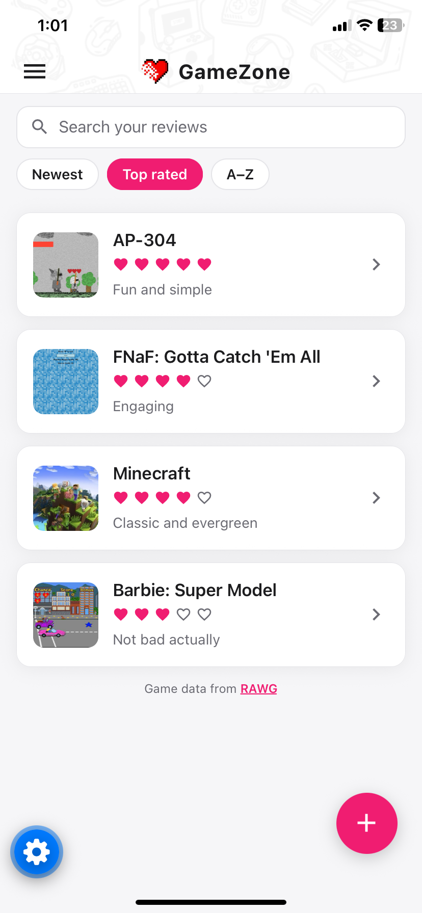
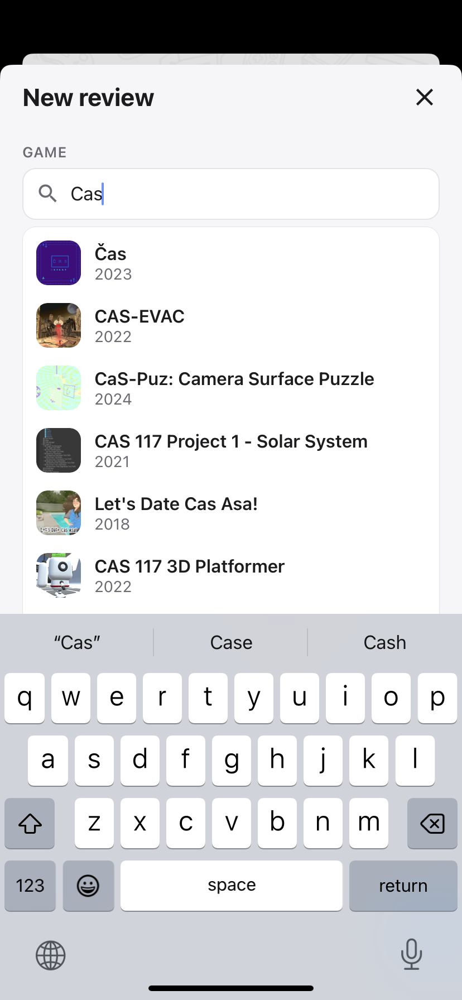
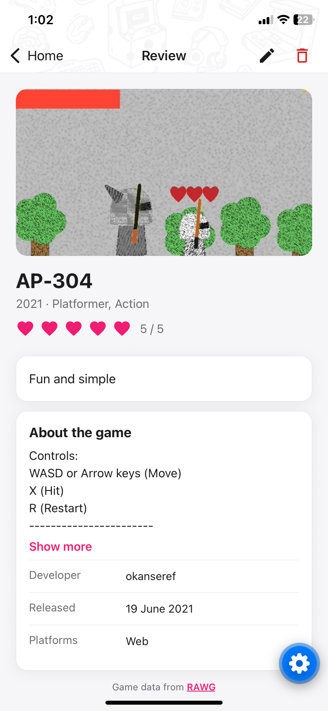
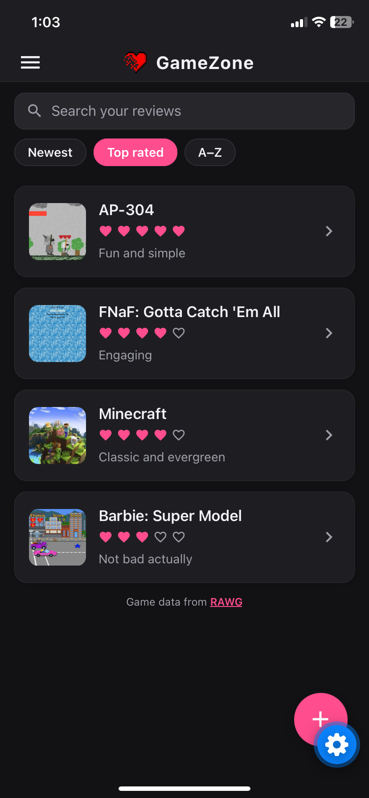
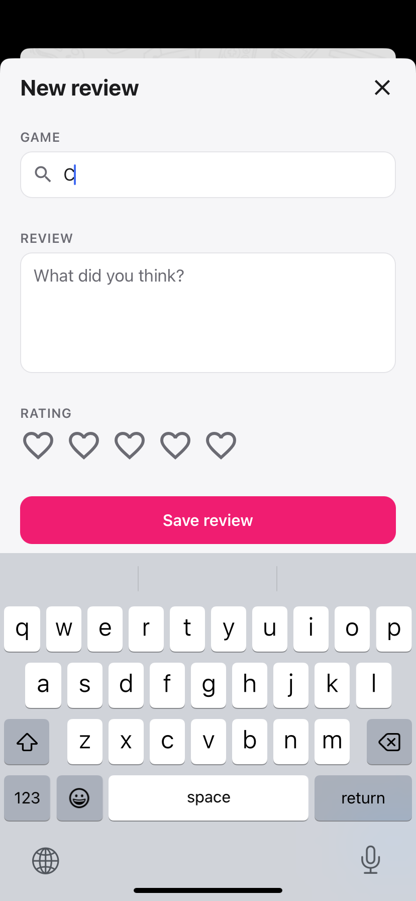
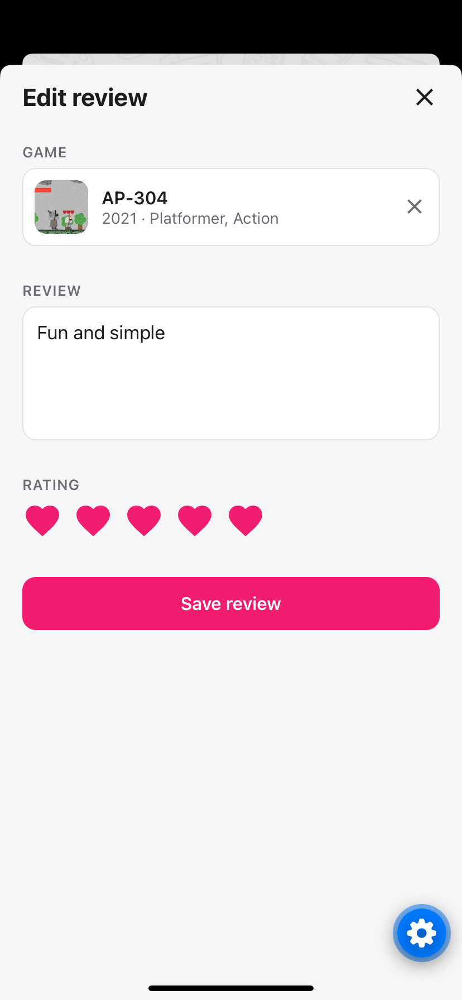
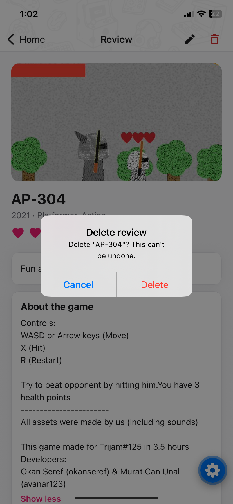
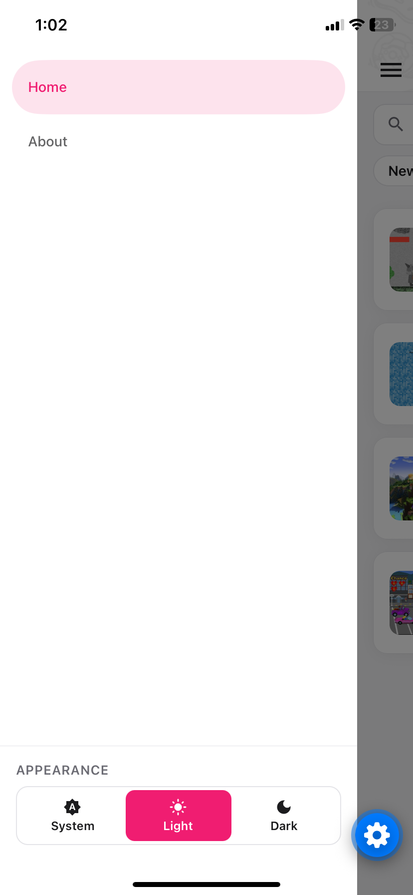
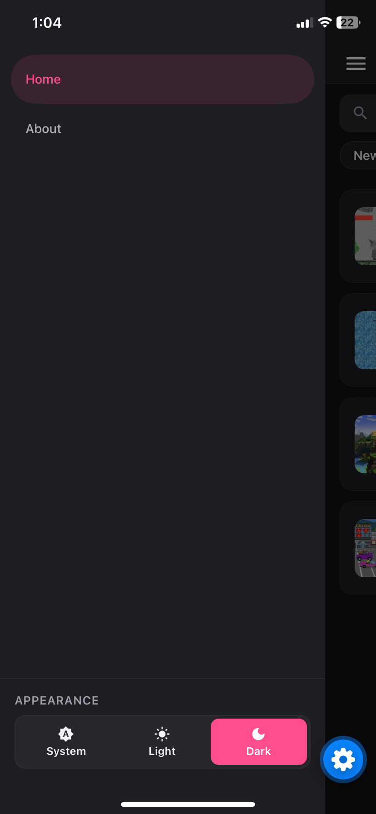
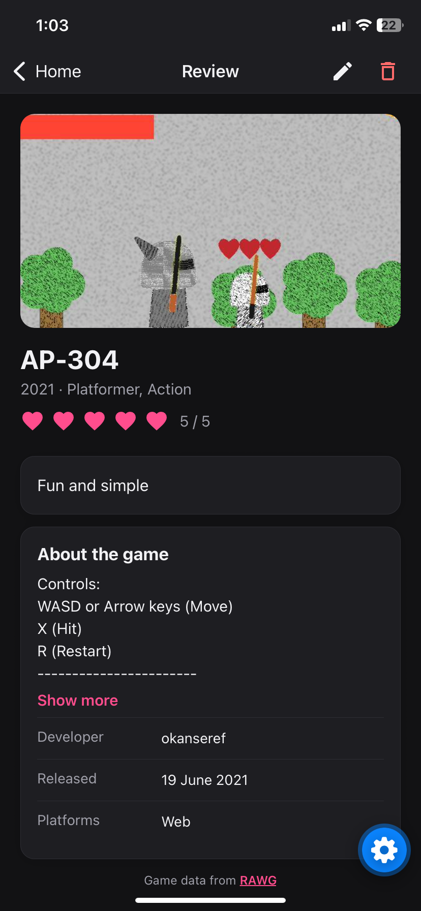

# GameZone

A mobile app for keeping a personal log of video game reviews. Search for any game, rate it out of five hearts, write your thoughts, and see each game's cover art, Metacritic score and details pulled from the [RAWG](https://rawg.io) video game database.

Built with **React Native**, **Expo** and **TypeScript**. Runs on iOS, Android and the web from a single codebase.

<p align="center">
  
  
  
  
</p>

## Features

- **Write, edit and delete reviews.** Each review has a title, your written review and a 1–5 heart rating, chosen by tapping the hearts.
- **Game search.** While writing a review, type a game's name to search RAWG's database of 900,000+ games. Picking a result links the game and adds its cover, release date, genres and platforms.
- **Game details.** Each review's page shows the game's description, developer, publisher, Metacritic score, average playtime, age rating and official website.
- **Search and sort your reviews.** Filter by title, review text or genre, and sort by newest, top rated or A–Z.
- **Works offline.** Reviews are saved on the device, along with the key details of each linked game.
- **Light and dark mode.** Follows the phone's setting by default, with an in-app switch (System / Light / Dark) that is remembered between launches.
- **Your stats.** The About page shows your number of reviews, your average rating and your number of 5-star games.

### More screenshots

| Writing a review | Editing | Deleting |
|:---:|:---:|:---:|
|  |  |  |

| Menu and appearance switch | Dark mode menu | Dark mode details |
|:---:|:---:|:---:|
|  |  |  |

## Tech stack

| Area | Tools |
|---|---|
| Framework | React Native 0.88, React 19, Expo SDK 58 |
| Language | TypeScript (strict mode) |
| Navigation | React Navigation 7 (drawer + native stack), with typed routes |
| Forms | Formik and Yup |
| Storage | AsyncStorage |
| Data | RAWG Video Games Database REST API |

## How it's built

A few decisions worth pointing out:

- **Typed navigation.** Every screen and its route parameters are typed ([routes/types.ts](routes/types.ts)), so a wrong screen name or missing parameter is caught when the code is checked, not when the app runs.
- **One shared source of review data.** Reviews live in a React context ([hooks/useReviews.tsx](hooks/useReviews.tsx)) that saves to device storage whenever the list changes. Writes are held back until the saved data has loaded, so the app can never overwrite your reviews with an empty list on startup.
- **Search that stays responsive and cheap.** Game search waits until you pause typing (400 ms), and cancels any request that is no longer needed when you keep typing ([shared/gameSearch.tsx](shared/gameSearch.tsx)). Game details are kept in memory for the session, so revisiting a review doesn't repeat the request ([api/rawg.ts](api/rawg.ts)). Both keep the app within RAWG's free monthly limit.
- **Details pages show the latest data.** Navigation passes only a review's ID, and the details screen reads the review from the shared list, so edits appear immediately everywhere.
- **Theme system.** Light and dark color sets live in one place ([styles/theme.tsx](styles/theme.tsx)). The user's choice is saved, and on phones it is also passed to the operating system so system pop-ups and the keyboard match the app.
- **Works on every platform.** Where a React Native feature doesn't work on the web (such as confirmation pop-ups), the app falls back to the browser's equivalent ([shared/confirm.ts](shared/confirm.ts)).
- **Follows the data provider's terms.** RAWG's terms require a link back to RAWG wherever its data appears, so every such screen shows one.

## Project structure

```
App.tsx              App entry: wraps the app in theme and review providers
api/                 RAWG API client (search, game details, caching)
docs/screenshots/    Screenshots used in this README
hooks/               Shared state: reviews (with storage) and game details
routes/              Drawer and stack navigators, plus route types
screens/             Home, Review Details, Review Form, About
shared/              Reusable components (cards, header, search, filters, rating hearts, …)
styles/              Theme (light/dark colors) and shared layout styles
types/               Review and game data types
```

## Running it locally

You'll need a current LTS version of [Node.js](https://nodejs.org). To run on a phone, install the **Expo Go** app.

1. Install dependencies:
   ```bash
   npm install
   ```
2. *(Optional, enables game search and details.)* Get a free API key from [rawg.io/apidocs](https://rawg.io/apidocs), then copy `.env.example` to `.env.local` and add your key:
   ```
   EXPO_PUBLIC_RAWG_API_KEY=your_key_here
   ```
   Without a key, the app still works; the game field is a plain text box.
3. Start the app:
   ```bash
   npm start
   ```
   Scan the QR code with Expo Go (or the iPhone camera), or press `i` for the iOS Simulator, `a` for an Android emulator, or `w` for the web.

### Scripts

| Command | What it does |
|---|---|
| `npm start` | Starts the Expo development server |
| `npm run ios` / `npm run android` / `npm run web` | Starts and opens on that platform |
| `npm run typecheck` | Checks the whole project with TypeScript |
| `npm run build:web` | Builds the web version into `dist/` |

### Deploying the web version

The web build is a static site, so any static host works. The repo includes a [Render](https://render.com) Blueprint ([render.yaml](render.yaml)): in Render, choose **New → Blueprint**, select this repo, and optionally enter a RAWG key when asked.

## What's next

- **Automated tests** for the review storage, search/sort logic and form validation.
- **A small backend proxy for RAWG.** Expo builds `EXPO_PUBLIC_` values into the app, so the API key is visible to anyone who inspects it. That's fine for a personal project, but a public release should route requests through a server that keeps the key private.
- **Cloud sync**, so reviews follow you across devices.

## Credits

Game data and images are provided by [RAWG](https://rawg.io).
